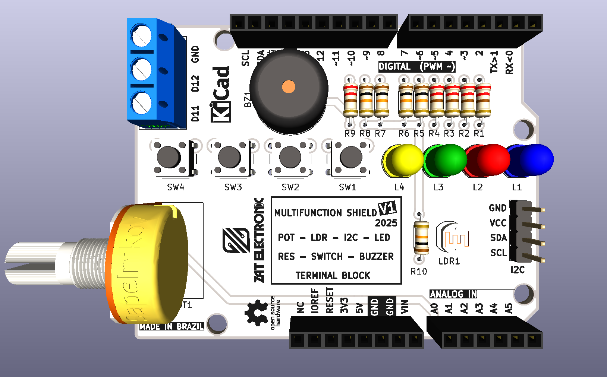
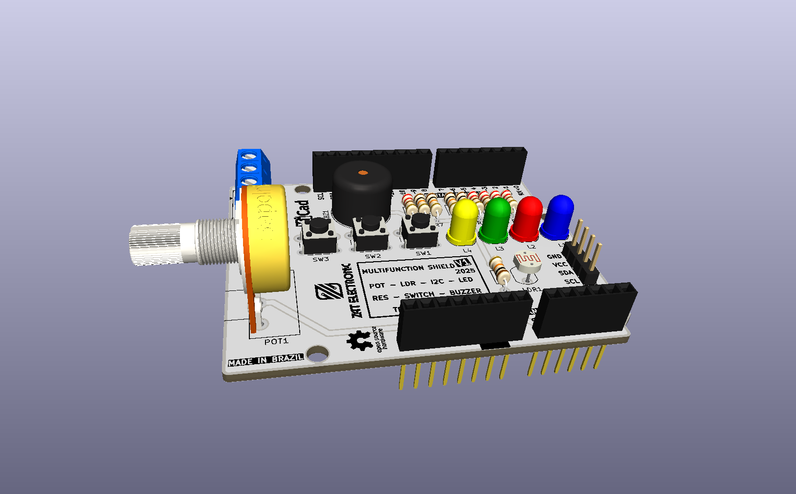
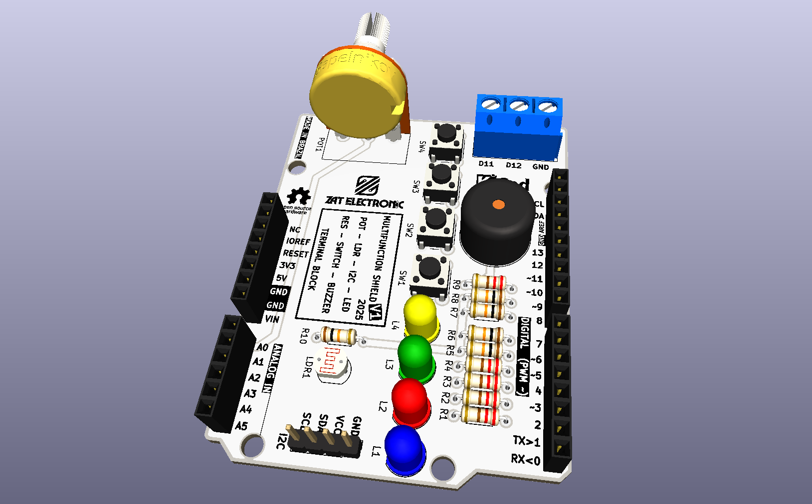

<div align="center">



# MULTIFUNCTION SHIELD V1

**Shield multifuncional para Arduino Uno com LEDs, botões, buzzer, potenciômetro, LDR, conector I2C e borne de terminais — tudo em uma única placa de expansão**

[](https://www.kicad.org/)
[](.)
[](.)
[](.)
[](.)
[](.)

</div>

---

## 📋 Índice

- [MULTIFUNCTION SHIELD V1](#multifunction-shield-v1)
  - [📋 Índice](#-índice)
  - [Visão Geral](#visão-geral)
  - [Renders 3D](#renders-3d)
  - [Funcionalidades](#funcionalidades)
  - [Mapa de Pinos](#mapa-de-pinos)
  - [Especificações Técnicas](#especificações-técnicas)
  - [Lista de Materiais](#lista-de-materiais)
  - [Aplicações](#aplicações)
  - [Estrutura do Repositório](#estrutura-do-repositório)
  - [Como Usar](#como-usar)
    - [Instalação](#instalação)
    - [Exemplo — Piscar os 4 LEDs em sequência](#exemplo--piscar-os-4-leds-em-sequência)
    - [Exemplo — Leitura do potenciômetro e LDR](#exemplo--leitura-do-potenciômetro-e-ldr)
    - [Exemplo — Botões com pull-down](#exemplo--botões-com-pull-down)
  - [Sobre](#sobre)

---

## Visão Geral

**MULTIFUNCTION SHIELD V1** é uma placa de expansão (shield) para **Arduino Uno R3**, projetada pela **ZAT ELECTRONIC** utilizando **KiCad 10**. O shield encaixa diretamente nos conectores do Arduino e disponibiliza um conjunto completo de periféricos prontos para uso imediato em projetos de aprendizado, prototipagem e experimentos com eletrônica e programação.

Em uma única placa são integrados: **4 LEDs coloridos**, **4 botões tácteis**, **1 buzzer**, **1 potenciômetro**, **1 sensor LDR**, **1 conector I2C** (GND / VCC / SDA / SCL) e **1 borne de terminais** — cobrindo as principais necessidades de entrada e saída para projetos com Arduino.

> 💡 Ideal para aulas, workshops, laboratórios maker e iniciantes em eletrônica e programação com Arduino.

---

## Renders 3D

<div align="center">


*Vista superior — LEDs coloridos, botões tácteis, buzzer, potenciômetro e LDR*

<br/>



*Vista isométrica frontal — pinout Arduino Uno R3 e conector I2C*

<br/>



*Vista isométrica traseira — borne de terminais, pinos analógicos e digitais*

</div>

---

## Funcionalidades

- ✅ **4 LEDs 5mm PTH** — azul (LED1), vermelho (LED2), verde (LED3) e amarelo (LED4)
- ✅ **4 botões tácteis** (SW1–SW4) — 6×6×5mm PTH, com resistores pull-up 10KΩ (ativos em nível baixo)
- ✅ **1 buzzer PTH** (BZ1) — sinalização sonora ativa
- ✅ **1 potenciômetro 10KΩ** (RV1) — entrada analógica ajustável
- ✅ **1 sensor LDR** (R2) — leitura de luminosidade ambiente (divisor com R1 10KΩ)
- ✅ **1 conector I2C** (J2 — 4 pinos: GND / VCC / SDA / SCL) — expansão para displays, sensores e módulos I2C
- ✅ **1 borne de terminais KRE 3 pinos** (J1 — D11 / D12 / GND) — conexão externa por parafuso
- ✅ **Resistores de proteção 220Ω** (R7–R11) — para os LEDs e buzzer
- ✅ **Resistores pull-up 10KΩ** (R1, R3–R6) — para LDR e botões
- ✅ **Encaixe direto** no Arduino Uno R3 — sem soldagem adicional no Arduino
- ✅ **Todos os componentes PTH** — montagem manual simples
- ✅ **Made in Brazil** — serigrafia na PCB

---

## Mapa de Pinos

| Periférico | Pino Arduino | Descrição |
|------------|-------------|-----------|
| **LED1** — LED Azul | D2 | Saída digital |
| **LED2** — LED Vermelho | D3 | Saída digital (PWM) |
| **LED3** — LED Verde | D4 | Saída digital |
| **LED4** — LED Amarelo | D5 | Saída digital (PWM) |
| **SW1** — Botão 1 | D6 | Entrada digital (LOW = pressionado) |
| **SW2** — Botão 2 | D7 | Entrada digital (LOW = pressionado) |
| **SW3** — Botão 3 | D8 | Entrada digital (LOW = pressionado) |
| **SW4** — Botão 4 | D9 | Entrada digital (LOW = pressionado) |
| **BZ1** — Buzzer | D10 | Saída digital (PWM) |
| **RV1** — Potenciômetro | A0 | Entrada analógica |
| **R2** — Sensor de luz (LDR) | A1 | Entrada analógica |
| **J2 SDA** — I2C Dados | A4 (SDA) | Comunicação I2C |
| **J2 SCL** — I2C Clock | A5 (SCL) | Comunicação I2C |
| **J1** — Borne | D11 / D12 / GND | Terminal externo |

---

## Especificações Técnicas

| Parâmetro | Valor |
|-----------|-------|
| **Compatibilidade** | Arduino Uno R3 (encaixe direto) |
| **LEDs** | 4x 5mm PTH — azul, vermelho, verde, amarelo |
| **Botões** | 4x tácteis 6×6×5mm PTH |
| **Buzzer** | 1x PTH ativo |
| **Potenciômetro** | 1x 10KΩ PTH |
| **Sensor de Luz** | 1x LDR PTH |
| **Conector I2C** | 1x header 4 pinos 2,54mm (GND / VCC / SDA / SCL) |
| **Borne de Terminais** | 1x KRE 3 pinos, passo 5,0mm (D11 / D12 / GND) |
| **Resistores LEDs/Buzzer** | 220Ω — R7, R8, R9, R10, R11 |
| **Resistores Pull-up** | 10KΩ — R1 (LDR), R3, R4, R5, R6 (botões) |
| **Tensão de operação** | 5V (alimentado pelo Arduino) |
| **Tipo de montagem** | PTH — Através-furo |
| **Ferramenta de Projeto** | KiCad 10 |
| **Versão** | V1 — 2025 |

---

## Lista de Materiais

| Ref | Componente | Valor / Cor | Encapsulamento |
|-----|-----------|------------|----------------|
| A1 | Arduino Uno R3 | — | Shield (encaixe) |
| LED1 | LED 5mm | Azul | PTH 5mm |
| LED2 | LED 5mm | Vermelho | PTH 5mm |
| LED3 | LED 5mm | Verde | PTH 5mm |
| LED4 | LED 5mm | Amarelo | PTH 5mm |
| SW1–SW4 | Botão Táctil | 6×6×5mm | PTH |
| BZ1 | Buzzer | Ativo | PTH |
| RV1 | Potenciômetro | 10KΩ | PTH |
| R2 | Sensor de Luz (LDR) | LDR 5mm | PTH Vertical |
| J1 | Borne de Terminais | D11 / D12 / GND | KRE 3 pinos 5,0mm |
| J2 | Conector I2C | GND / VCC / SDA / SCL | Header 4 pinos 2,54mm |
| R7, R8, R9, R10, R11 | Resistor de proteção | 220Ω | Axial DIN0204 PTH |
| R1, R3, R4, R5, R6 | Resistor pull-up | 10KΩ | Axial DIN0204 PTH |

---

## Aplicações

- 🎓 **Ensino de eletrônica e programação** — plataforma completa para aprender Arduino do zero
- 🔬 **Prototipagem rápida** — periféricos prontos sem necessidade de protoboard
- 🏫 **Laboratórios maker e escolas técnicas** — kit de experimentos em uma única placa
- 🎮 **Projetos interativos** — jogos, quizzes e desafios com LEDs e botões
- 📡 **Integração com módulos I2C** — displays OLED, sensores de temperatura, RTC, etc.
- 🔊 **Projetos sonoros** — alarmes, melodias e sinalizações com buzzer
- 🌅 **Automação com luz** — controle baseado em luminosidade via LDR

---

## Estrutura do Repositório

```
MULTIFUNCTION_SHIELD_V1/
├── MULTIFUNCTION_SHIELD_V1.kicad_pro        # Arquivo de projeto KiCad
├── MULTIFUNCTION_SHIELD_V1.kicad_sch        # Esquemático: capa A2 + folhas ARDUINO / ENTRADAS / SAIDAS (KiCad 10)
├── MULTIFUNCTION_SHIELD_V1.kicad_pcb        # Layout da PCB (KiCad 10)
├── MULTIFUNCTION_SHIELD_V1.kicad_prl        # Configurações locais
├── packages3D/                              # Modelos 3D arquivados
│   ├── LED 5mm Blue.step
│   ├── LED 5mm Red.step
│   ├── LED 5mm Green.step
│   ├── LED 5mm Yellow.step
│   ├── SW_PUSH_6mm_H5mm.wrl
│   ├── Buzzer_12x9.5RM7.6.wrl
│   ├── Rez10K.stp
│   ├── R_LDR_5.1x4.3mm_P3.4mm_Vertical.wrl
│   ├── DG306-5.0-03P-12-00AH.STEP
│   ├── PinHeader_1x04_P2.54mm_Vertical.wrl
│   ├── SIL_Socket06_.stp
│   ├── SIL_Socket08_.stp
│   ├── SIL_Socket10_.stp
│   └── Resistor Axial 0.5W *.STEP
├── fp-info-cache                            # Cache de footprints
├── imagem_1.png                             # Render 3D superior
├── imagem_2.png                             # Render 3D isométrico frontal
├── imagem_3.png                             # Render 3D isométrico traseiro
└── README.md
```

---

## Como Usar

### Instalação

1. Encaixe o **MULTIFUNCTION SHIELD V1** diretamente nos conectores do Arduino Uno R3
2. Conecte o Arduino ao computador via USB
3. Abra a **Arduino IDE** ou **PlatformIO** e selecione a placa **Arduino Uno**
4. Carregue seu sketch e comece a experimentar

### Exemplo — Piscar os 4 LEDs em sequência

```cpp
#define LED_AZUL    2
#define LED_VERMELHO 3
#define LED_VERDE   4
#define LED_AMARELO 5

void setup() {
  pinMode(LED_AZUL,     OUTPUT);
  pinMode(LED_VERMELHO, OUTPUT);
  pinMode(LED_VERDE,    OUTPUT);
  pinMode(LED_AMARELO,  OUTPUT);
}

void loop() {
  digitalWrite(LED_AZUL, HIGH);    delay(300);
  digitalWrite(LED_AZUL, LOW);
  digitalWrite(LED_VERMELHO, HIGH); delay(300);
  digitalWrite(LED_VERMELHO, LOW);
  digitalWrite(LED_VERDE, HIGH);   delay(300);
  digitalWrite(LED_VERDE, LOW);
  digitalWrite(LED_AMARELO, HIGH); delay(300);
  digitalWrite(LED_AMARELO, LOW);
}
```

### Exemplo — Leitura do potenciômetro e LDR

```cpp
void setup() {
  Serial.begin(9600);
}

void loop() {
  int pot = analogRead(A0); // potenciômetro
  int ldr = analogRead(A1); // sensor de luz
  Serial.print("POT: "); Serial.print(pot);
  Serial.print(" | LDR: "); Serial.println(ldr);
  delay(500);
}
```

### Exemplo — Botões com pull-up (pressionado = LOW)

```cpp
#define BTN1 6
#define BTN2 7
#define BTN3 8
#define BTN4 9
#define BUZZER 10

void setup() {
  pinMode(BTN1, INPUT);
  pinMode(BTN2, INPUT);
  pinMode(BTN3, INPUT);
  pinMode(BTN4, INPUT);
  pinMode(BUZZER, OUTPUT);
}

void loop() {
  if (digitalRead(BTN1) == LOW) {
    tone(BUZZER, 1000, 200); // aciona buzzer ao pressionar SW1
  }
}
```

## Sobre

<div align="center">

Projetado por **ZAT ELECTRONIC**

*MULTIFUNCTION SHIELD V1 — 2025 — Made in Brazil 🇧🇷*

[](https://www.kicad.org/)
[](https://www.oshwa.org/)

</div>